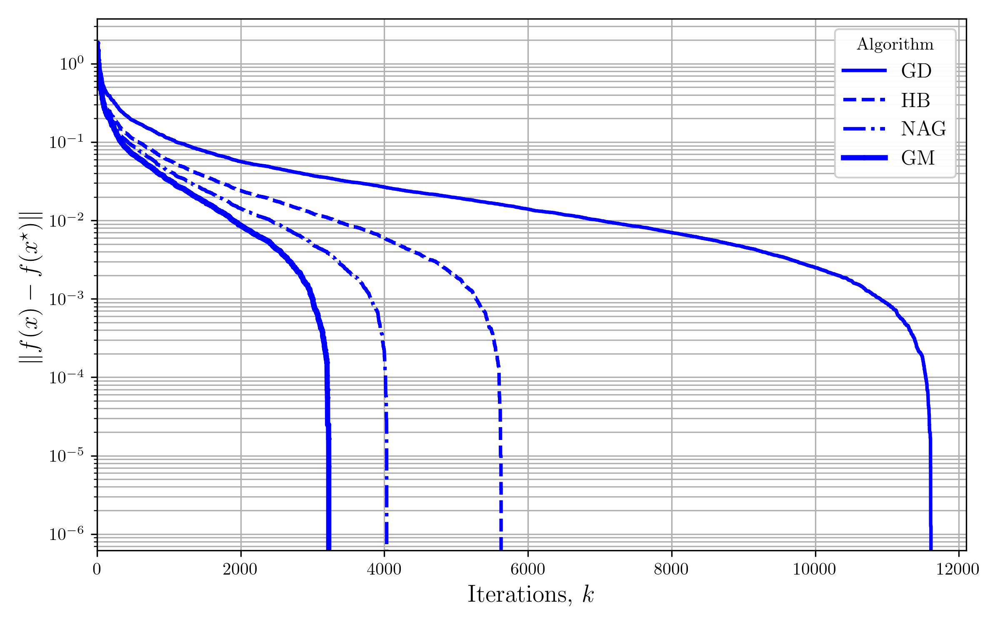

A Totally Asynchronous Generalized Momentum Algorithm Simulation
============

This is the simulation for the "A Totally Asynchronous Generalized Momentum Algorithm" paper. The example data set used here is the Fashion-MNIST dataset. A multi-class logarithmic regression model is used for benchmarking.

